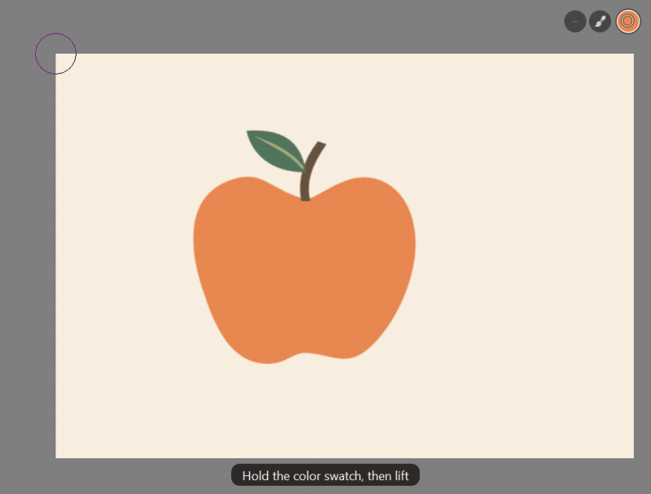
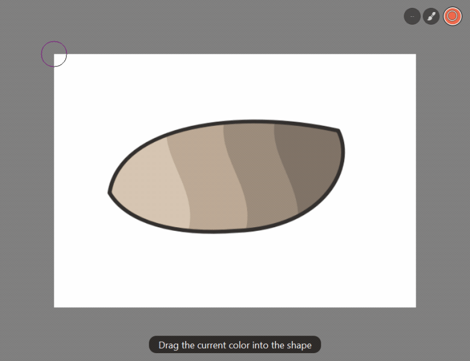
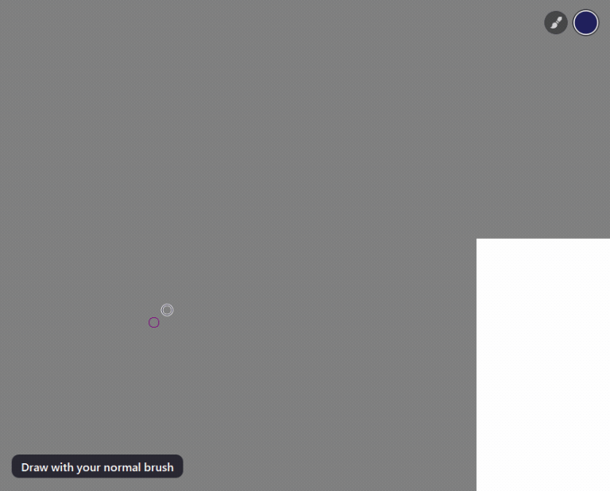

# ProKrita

Drawing gestures for the normal freehand brush in desktop Krita 5.3.2.1.

**Separate versions:** desktop plugin: `dist/pc/ProKrita-PC.zip`. Android ARM64 app: `dist/android/ProKrita-Android-arm64-v8a.apk`, the 17 November gap-closing, Quick menu and floating Layers build is ready; tablet installation is pending because no device is connected. The previous build was tested on Lenovo hardware. Native source and instructions: [android/README.md](android/README.md).

Round gestures now prefer procedural circles when mild stretching or pen wobble makes the intent ambiguous. Recognition compares circle and oval errors in normalized coordinates and adapts its tolerance to local wobble. Clearly elongated loops remain ovals; circle edit handles keep both radii equal.

**Android tablets:** install the separate APK and open **ProKrita Android**. The desktop Python ZIP is for PC Krita. The custom Android app includes native shape snapping and a floating ProKrita canvas strip, brush picker, quick smudge, ColorDrop with tiny-gap closing and an Auto stabilizer; its feature coverage differs from the desktop plugin.

**Blend across layers.** Choose **⋯ → Smudge visible layers on a new layer**. Blend on the new transparent **Smudge blend** layer, then tap **Paint** to resume drawing. Each stroke samples the visible colors. Edits underneath show through the untouched areas. Laptop installation instructions in English and French are in [README-Install.txt](README-Install.txt).

**Blend, then keep drawing.** Tap **Smudge** beside the canvas color swatch and brush across the edge between a shadow and a highlight on the same paint layer. Lift your pen or mouse to get your drawing brush and its settings back. For several strokes, hold **Smudge** until it reads **Keep on**, then lift. Tap **Paint** or press **Esc** when you're done. You can adjust the blender's **Size** and **Opacity** in the shading palette or the toolbar. Smudge remembers both for next time. Each stroke has its own Undo.

**Shade from one base color.** Choose **⋯ → Shading palette**. Tap a shadow or highlight and keep painting. The middle **Base** chip restores the exact original color. Picking a different foreground color starts a new set. The five tones use perceptual lightness and retain the source color profile and alpha. The **Size** and **Opacity** sliders control your current brush. Tap or drag anywhere on a slider with a mouse or pen.

**Keep shading inside your flats.** Put the flat colors on a paint layer with transparent surroundings. In the shading palette, **Lock alpha** preserves that layer’s transparency, including its soft edges. **Clip layer** groups the selected layers and adds a separate clipped paint layer above them. Paint shadows there and use the Layers docker to hide them or adjust their opacity later.

**Drop color.** Drag the round foreground swatch from the upper-right of the canvas into a region. Lift for a quick fill, or pause there for about a third of a second until the percentage appears. Keep holding and slide right to include more neighboring tones or left to include fewer. The crosshair stays at the original seed. Lift to commit one undoable fill. Krita remembers your last threshold. Escape or a release outside the canvas cancels the gesture.

**Fill several regions.** After a drop, tap **Continue filling** at the top of the canvas. Tap each additional region to fill it with the current foreground color. You can change colors between taps or hold on a region and slide to adjust its threshold. Each fill has its own Undo. **Done filling** or **Esc** returns you to your tool. Starting a brush stroke while the initial invitation is showing dismisses it.

**Draw and hold.** Draw with the normal brush on an unlocked paint layer. Lift for an ordinary freehand stroke. Hold still for about half a second to fit a line, arc, cornered polyline, flowing curve, circle, tilted oval, triangle or quadrilateral. Move the tip to steer an open stroke from its starting point. Move around the center of a closed shape to rotate it, or toward and away from the center to resize it. Lift to ink with your current preset. A pressure-sensitive preset receives the pressure, tilt and rotation samples from the drawn stroke, in drawing order.

**Edit a shape.** Tap **Edit Shape** while the snapped stroke is the latest edit. Pull an endpoint, corner, curve handle or ellipse axis. Drag the center to move the shape. Tap **Done** to draw again. Undo removes the adjusted stroke in one step. Open **⋯ → Refine last shape** to turn an arc into a semicircle, an oval into a circle, a triangle into an equilateral triangle, or a four-sided shape into a square or rectangle.

**Color transparent ink.** **⋯ → Seal ink edges** is on by default. It closes small breaks, extends color into antialiased edges and uses Krita's Behind blending when filling fully transparent pixels with a normal brush blend. Turn it off to use your bucket's own edge settings. Enable **Use visible layers as fill reference** when inking and coloring on separate layers. The live tint is a reduced-resolution guide. Krita paints the full-resolution result using the document profile, active selection and fill settings. With a color-labeled reference the tint uses the visible composite and the final fill uses the chosen labels.

**Select and smooth.** After snapping a closed shape, open **⋯ → Select inside last shape** to replace, add to, or subtract from the current selection. The menu also opens the native freehand lasso, polygon lasso and color selection tools. **Pen smoothing** gives access to Krita's basic, weighted, stabilizer and pixel-perfect modes. Tap the round swatch to open your preferred picker. Choose **Krita default** or **Square + hue** under **⋯ → Color picker**. The square uses saturation from left to right and brightness from bottom to top. Drag the rainbow strip to change hue and lift to apply. The same menu opens Krita’s MyPaint Shade Selector. Tap the adjacent brush button to choose a preset.

**Install.** On this computer the plugin lives in Krita's user resource folder. Restart an open Krita session to load an update. On another computer, use **Tools > Scripts > Import Python Plugin from File**, choose **ProKrita.zip**, enable ProKrita in **Settings > Configure Krita > Python Plugin Manager**, and restart.

The Windows integration check in **tests/run-krita.ps1** opens a scratch Krita profile. It exercises native mouse and tablet events, compares fill masks and painted pixels, measures pressure-sensitive stroke widths, checks color profiles and alpha, and verifies clipped layer composition, smudging, brush restoration and undo history.
